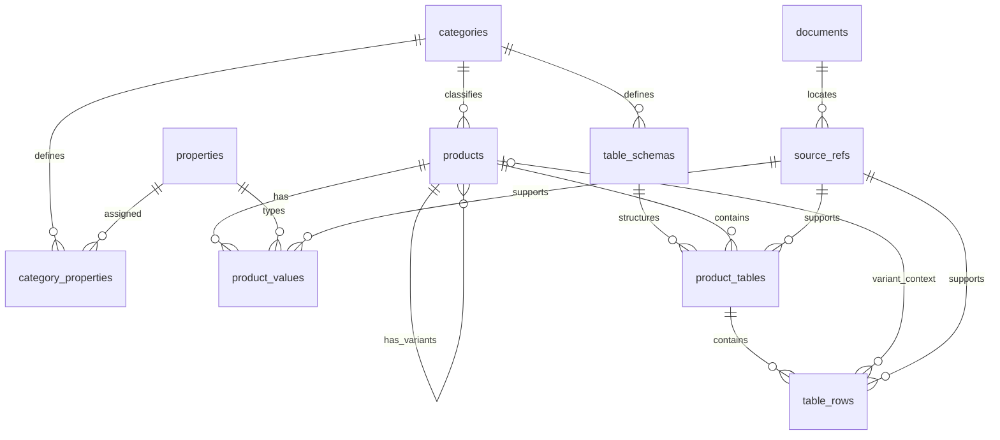

# SupplierAtlas database design

## Selection-driven projection requirements (2026-10-15)

Optional schema `context_columns` lists existing columns whose values are necessary
to interpret projected evidence (e.g. a leakage class's test temperature). Import
validation rejects unknown/duplicate/non-string references. Both search evidence
and known-product rows return row keys + context columns + requested columns,
deduplicated in that order, with units, context, notes and sources retained.
This metadata is additive and does not change row identity, column meaning or the
three public request schemas. Catalog release/hash changes invalidate old cursors.
An empty first page with numeric predicates explains scalar-only matching and
excluded bounds/missing cells; it does not assert product unsuitability.

Updated: 2026-10-15. Status: implemented SQLite design exercised across all 22 Alsharqa catalog families.

## Expanded dataset implementation

The reviewed package contains 37 models, 758 variant/reference records, 76 schemas
and tables, and 3,707 rows. A variant can identify a published size, configuration
or reference series; it does not prove that every listed combination is orderable.
The original 42 SCD records and their IDs remain stable.

Product facts remain table-local where their meanings or values differ. For
example, supply and return neck areas can conflict in the source; they are not
merged into an invented authoritative property. Discover table columns before
filtering; the original product-level neck properties are not populated universally.

Schemas preserve A/B throws, pattern and velocity axes, frequency bands, active
length, pressure/flow units and missing states. Source notes accompany retrieval
and search evidence. Unspecified units stay null; the API rejects incompatible
conversions. Temperature values remain in their printed units (no C/F conversion).

Expanded queries keep the same public request schemas. Explicit table requests
return only those table summaries and omit variant overviews. Expanded source
locators are deduplicated by reference ID. Default model overviews disclose a
20-variant preview limit; table rows remain filtered, projected and cursor-paginated.

Reviewed Python matrices and the source inventory are versioned; generated
catalog JSON/SQLite snapshots are build outputs. `audit.py` checks every identified
table page has an imported, duplicate or withheld disposition and produces the
coverage and source-qualification reports.

## Implementation mapping

`src/supplier_atlas/ingestion.py` contains the current schema. The 11 logical
entities below are implemented, with some descriptive fields grouped in validated
JSON definitions/metadata. Cell bounds and missing states are tagged JSON values.
Source values are retained in published units; compatible filter units are converted
at query time. Separate normalized/original-value columns are not yet needed.

The current demo supports scalar values, qualified numeric bounds, sparse rows,
table-specific context, explicit variants and paged row queries. General nested
range/curve schemas and external heavy-data storage remain design extensions;
do not describe these as already production-qualified. Import packages currently
load in memory; the 5,000-row synthetic test verifies bounded retrieval, not
unlimited ingestion scalability. Database migration support is format-version
rejection and a reproducible fresh snapshot build, not an in-place upgrade engine.

## Core approach

Content scope: engineering tables and the concise context necessary to use them.
Do not store advertising or general company/product narrative as searchable
product content. Identity, configuration, units, and technical notes remain.

Use a relational catalog with typed, schema-validated attributes and technical
tables. Fixed identity and relationships live in relational columns. Variable
table rows use validated JSON objects keyed by stable column codes, so adding a
product category does not require category-specific MCP tools or database tables.

The initial SQLite snapshot is read-only while serving requests. Reviewed imports
build a new immutable snapshot. Keep published snapshots and their build manifests
outside ephemeral service writes; deploy a chosen snapshot with each service
revision and retain the previous one for rollback.

## Proposed tables

| Table | Main columns | Responsibility |
|---|---|---|
| `catalog_release` | `id`, `schema_version`, `content_version`, `built_at`, `manifest_hash` | Identify the immutable dataset; one active release per snapshot |
| `categories` | `id`, `parent_id`, `code`, `label`, `description` | Product taxonomy with stable IDs |
| `properties` | `id`, `code`, `label`, `definition`, `value_type`, `quantity_kind`, `canonical_unit`, `allowed_values_json` | Shared dictionary of typed technical concepts |
| `category_properties` | `category_id`, `property_id`, `applicability`, `filterable`, `required`, `display_order` | Define which properties apply to a category and at model/variant level |
| `products` | `id`, `kind`, `parent_id`, `category_id`, `brand_key`, `model_code`, `variant_code`, `label` | A model record and its explicit variant records |
| `product_values` | `product_id`, `property_id`, `value_json`, `value_status`, `qualifier`, `original_value_json`, `original_unit`, `source_ref_id` | Scalar, enumerated, Boolean, range, or set specifications |
| `table_schemas` | `id`, `category_id`, `code`, `version`, `label`, `definition`, `columns_json`, `context_schema_json` | Typed definitions of technical tables and their operating context |
| `product_tables` | `id`, `product_id`, `schema_id`, `label`, `context_json`, `notes_json`, `source_ref_id` | A table belonging to a model or variant with its common conditions |
| `table_rows` | `id`, `table_id`, `variant_id`, `sequence`, `values_json`, `cell_status_json`, `original_values_json`, `source_ref_id` | One complete published row; cells stay associated |
| `documents` | `id`, `title`, `revision_label`, `published_date`, `sha256`, `storage_key`, `public_url` | Original datasheet identity and revision; unknown dates remain null |
| `source_refs` | `id`, `document_id`, `pdf_page`, `printed_page`, `table_label`, `row_label`, `locator_json` | Locate the evidence for an attribute, table, or row |

Credentials, user accounts, and operational logs are not part of the distributed
product catalog snapshot. No supplier-history or supplier-rating tables exist.
`brand_key` is identification metadata, not an evaluation entity.

## Relationships



## Models and variants

- `products.kind` is `model` or `variant`. A model has no parent; a variant's
  parent must be a model in the same category. Reject cycles and deeper nesting
  for the demo.
- A model holds shared properties, such as material. A variant holds differences,
  such as neck dimensions. A resolved variant view combines inherited and local
  values and can report their origin when requested.
- Absence of a variant value means inherit from the model. An explicit unknown
  or not-applicable value overrides inheritance rather than silently falling back.
- Create only published variants, not every theoretical size/option combination.
  Catalog options that do not identify a published variant remain typed properties.
- Manufacturer model codes are not globally unique. Stable internal IDs and a
  brand/model/variant identity key prevent cross-brand collisions.

## Technical values and units

- `properties.value_type` governs JSON type, permitted qualifiers and operators.
  Store numbers as numbers rather than combined strings such as `"250 mm"`.
- `quantity_kind` distinguishes concepts beyond dimensional units: neck width
  and face width, total pressure and static pressure, or different acoustic metrics.
- Normalize compatible units at import and retain their original representation.
  Unit conversion is not interpolation or a calculated performance prediction.
- Preserve bounds (`<`, `<=`, `>`, `>=`), ranges, and missing-value status. The
  initial numeric search excludes qualified bounds unless a proven operator rule
  can evaluate them; it never treats a bound as an exact measurement.
- Unknown, not supplied, and not applicable are explicit states. A field omitted
  by the response projection is not evidence that the database lacks it.
- Schema changes create a new schema version; they do not silently redefine a
  property code or table column used in a published dataset.

## Technical tables

Every `table_schemas.columns_json` entry defines a stable code, property reference,
data type, unit, role (input/output/descriptor), and permitted operators. A table's
context schema defines meaningful conditions outside the row, such as a common
configuration or test condition. Category-specific engineering content lives here.

A `table_rows.values_json` object stores the cells of one published row together.
`variant_id` is required for a model-owned table when the row applies to a specific
variant. For a variant-owned table, it must agree with the owner. Reject rows with
uncertain applicability rather than assigning them to every variant.

One physical PDF table may need multiple logical tables when headers or conditions
change. Conversely, a continued table across pages may form one logical table,
with row-level source references preserving the individual page locations.

"Row" means a complete logical engineering record, not necessarily one horizontal
line on the PDF. Transpose cross-tabulated data into explicit operating points
while preserving merged-header associations and cell locators. Keep paired outputs
such as throw at two terminal velocities associated with their respective axes;
do not mistake them for a generic minimum/maximum range. The Egyptian source review
in `SOURCE_RESEARCH.md` documents concrete examples of these requirements.

Table-level sources/notes apply to all rows unless a specific row carries more
precise evidence. Return common context once. Do not strip notes that qualify the
requested values, even when the caller requests only a subset of columns.

For the demo, row-level evidence is enough where cells share one source location.
If a row combines multiple source locations, require per-column locators in the
source reference or keep separate rows; do not falsely attribute the whole row
to a single table. Conflicting published values remain separate contextualized
records and are flagged during review, not silently overwritten.

## Illustrative response shape

The following is a structure example, not actual supplier data. `null` means not
supplied in this example, not zero. The definitive columns will come from the file.

```json
{
  "catalog_version": "demo-001",
  "product_id": "example-model",
  "table": {
    "id": "example-performance",
    "columns": [
      {"code": "airflow", "type": "number", "unit": "L/s"},
      {"code": "pressure_drop", "type": "number", "unit": "Pa"}
    ],
    "context": {"variant_id": "example-size", "conditions_status": "not_supplied"},
    "rows": [{"id": "example-row", "values": [100, null],
              "cell_status": {"pressure_drop": "not_supplied"}}],
    "source_ref": "example-document-page-table",
    "next_cursor": null
  }
}
```

Internal row JSON uses keys for validation/querying. External positional arrays
reduce repeated tokens because the column schema is returned once. Required
condition and source labels can be resolved in the same response; there is no
requirement for another tool call.

## Query behavior and indexes

- Search models/variants using category and identity indexes; optionally use
  full-text search for names, aliases, and descriptive text.
- Filter scalar values through property IDs and validated typed values.
- Filter technical rows with predicates grouped in one relational `EXISTS`
  expression for the same table, row, and variant. Independent product-level
  existence checks must not accidentally match different operating points.
- Use parameterized SQL and allowlisted schema fields. Do not accept arbitrary
  SQL, arbitrary JSON paths, or agent-defined executable expressions.
- Index product/category/parent keys, value product/property keys, table owners,
  table schemas, and row table/variant keys. Add expression indexes for frequently
  filtered row fields based on actual query measurements.
- Cursors bind the catalog version, filters, sort order and last result position.
  Requests pinned to an unavailable release receive an explicit version error,
  never a silent continuation against different data.
- Validate references into JSON schemas in the importer in addition to relational
  foreign keys. Enable SQLite foreign-key enforcement and reject invalid builds.

## Growing the database

### Different products, table shapes, and data sizes

- Category definitions are discoverable vocabulary, not a mandatory giant row.
  `required` applies only to a declared applicable schema/profile. A product with
  no acoustic data is not forced to fabricate an acoustic table or empty columns.
- A category can have many table schemas; each product selects the schemas it
  actually has. Schema-specific extra properties are namespaced and typed until
  a sound canonical mapping is established. Preserve the supplier's original label.
- A product can expose dimension tables, performance tables, accessory effects,
  allowable operating ranges, or configuration matrices independently. Row keys
  and axis definitions are declared by the table schema, not hard-coded by the API.
- `columns_json` includes role, type, quantity, unit, null/qualifier policy and
  optional nested field definitions. `context_schema_json` describes common
  conditions; a schema also declares the row-key/axis combination and allows
  repeated points only when an additional condition or replicate ID distinguishes
  them. Flatten merged headers into explicit context/axes, not ambiguous strings.
- Keep incomplete/sparse rows sparse. Preserve published bounds, dashes and
  footnote meanings with per-cell status and qualifier metadata. Do not infer
  missing measurements or expand unlisted combinations into fake records.
- Technical curves can be stored as published point series under a suitable
  table schema. Values only present in images require a separate reviewed
  digitization step; they must not be presented as exact published table cells.
- For small/medium tables, the initial `table_rows` representation remains
  adequate. Large datasets use indexed row subsets and streaming imports; no
  unbounded JSON document per product. Product detail lists table descriptors
  (schema ID, axes, row count and coverage), loading rows only on request.
- If measured size/performance warrants external columnar partitions later,
  add a storage adapter and partition manifest with checksums/version and predicate
  pushdown. SQLite holds searchable metadata and indexes; large data resides in
  immutable object storage. This is an extension point, not a demo dependency.
- Storage optimization must preserve the same three-tool contract, row identity,
  qualifiers, version pinning and completeness metadata. Verify this with sparse,
  multi-axis and heavy-data fixtures before claiming those paths supported.

A second supplier adds products, documents, and rows using existing definitions.
A new category adds category-property assignments and technical-table schemas.
Shared properties retain their meaning. Supplier-specific labels map to canonical
properties only when their meanings match; otherwise preserve separate concepts.

This design intentionally avoids a hard-coded `air_outlets` table and an
unvalidated collection of arbitrary property names. The same three tools remain
the public interface. Database-engine migration is possible later, but not free:
JSON queries, indexes and query semantics would need migration tests.
